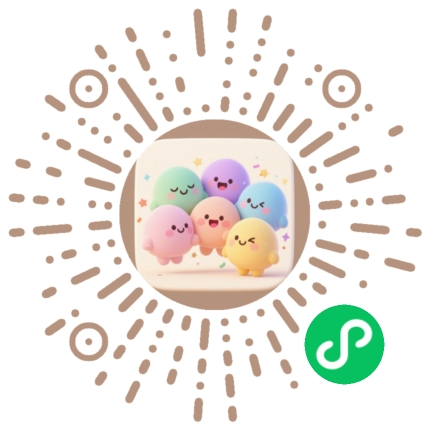

# 他晓风格公众号推文 Skill(v5 · 备注:公众号AI速递推文)

## 概述

暖色极简编辑风格的微信公众号推文写作与排版规范。核心特征：**暖色极简 + 编辑卡片式布局 + 全内联样式 + 图文视频混排**，确保粘贴到微信编辑器后格式完美保留。集成他晓品牌联系方式区块，推文结尾自动展示社群邀请与二维码。

## 一、设计哲学

- **暖色极简**：不用纯白背景，用 #fdfdf8 暖米色，营造纸质感
- **编辑卡片式**：所有内容块用 border + border-radius 包裹，形成卡片层级
- **单色系 + 单一强调色**：暖灰主色 + 橙色 #ed7b2f 作为唯一强调色
- **暗色标题栏**：卡片头部用 #1e1f23 深色条，形成强对比
- **全内联样式**：不使用 `<style>` 标签或 CSS class，微信完美兼容
- **全 section 标签**：使用 `<section>` 而非 `<div>`，微信原生支持
- **装饰元素非空铁律**：纯装饰的 `<span>`/`<section>`(圆点、分隔线、竖线)禁止留空,必须填 `&nbsp;` 并加 `overflow:hidden;vertical-align:middle;font-size:0;line-height:0;`,否则粘贴时微信编辑器会剥离空元素、装饰全丢

## 二、配色系统

| Token | 色值 | 用途 |
|-------|------|------|
| `--bg` | `#fdfdf8` | 主背景（暖米白） |
| `--card-bg` | `#eeefe9` | 卡片内容区背景（浅暖灰） |
| `--dark` | `#1e1f23` | 暗色标题栏、banner |
| `--text-dark` | `#23251d` | 标题、重要文字 |
| `--text-body` | `#4d4f46` | 正文文字 |
| `--text-mid` | `#65675e` | 副标题、说明文字 |
| `--text-light` | `#9ea096` | 标签、时间戳 |
| `--border` | `#bfc1b7` | 所有边框 |
| `--accent` | `#ed7b2f` | 橙色强调（下划线、圆点、边框） |
| `--code-bg` | `#1E293B` | 代码/计算块背景 |
| `--code-header` | `#0F172A` | 代码块标题栏 |
| `--code-text` | `#E2E8F0` | 代码块文字 |
| `--code-label` | `#94A3B8` | 代码块标签 |
| `--tag-bg` | `#e5e7e0` | 标签胶囊背景 |
| `--highlight-bg` | `#d4c9b8` | 高亮按钮背景 |
| `--highlight-border` | `#b17816` | 高亮按钮边框 |

## 三、字体规范

- **正文字体**：`'IBM Plex Sans', -apple-system, system-ui, 'PingFang SC', 'Hiragino Sans GB', 'Microsoft YaHei', sans-serif`
- **代码字体**：`'SF Mono', Consolas, Monaco, monospace`
- **标题字号**：24px / weight 800
- **副标题字号**：18px / weight 800
- **段落标题**：17px / weight 800
- **段落副标题**：11px / weight 600 / letter-spacing: 1.2px
- **正文**：14px / line-height: 1.9 / text-align: justify
- **图片说明**：13px / color: #65675e / text-align: center
- **标签文字**：10px / weight 700-800 / letter-spacing: 2-4px

## 四、写作风格

### 4.1 语气与定位
- **定位**：实测/评测/对比类内容，专业但有个人视角
- **语气**：客观陈述事实 + 明确个人判断，不说套话
- **人称**：第一人称「我」为主，拉近距离
- **句式**：短句为主，每段 2-4 句，信息密度高

### 4.2 标题规范
- **主标题**：产品/模型名 + 冲突点，如「Seedance 2.0 Fast 对上 H3！」
- **副标题**：个人结论 + 悬念，用橙色下划线强调关键词
- **示例**：主标题「X 对上 Y！」→ 副标题「贵 N 元，我却选它继续剪」

### 4.3 段落编号
- 格式：`01` `PART`（大号数字 + 小号标签）
- 每段标题：核心观点（17px粗体）
- 每段副标题：补充说明（11px粗体，letter-spacing）

### 4.4 强调方式
- 关键词用橙色下划线：`border-bottom:2px solid #ed7b2f; font-weight:600; color:#23251d;`
- 小结用 callout 框：左侧橙色边框 + 标签

### 4.5 结构模式

```
开头引入（Header卡片 + 暗色Banner + 引言卡片）
→ 视频嵌入区（虚线边框容器 × N）
→ 编号段落 01-07
  → 每段：编号标题 + 正文 + 图片/表格/callout
→ MY TAKE（暗色引用框）
→ FULL PROMPT（代码块）
→ YOUR TAKE（互动投票卡片）
→ 他晓联系方式区块（社群邀请 + 双二维码 + CTA按钮组 + 版权）
```

## 五、组件模板（复制即用）

### 5.1 最外层容器
```html
<section style="max-width:677px;margin:0 auto;padding:8px;box-sizing:border-box;background:#fdfdf8;color:#4d4f46;font-family:'IBM Plex Sans',-apple-system,system-ui,'PingFang SC','Hiragino Sans GB','Microsoft YaHei',sans-serif;line-height:1.75;">
```

### 5.2 Header 卡片
```html
<section style="background:#fdfdf8;border:1px solid #bfc1b7;border-radius:6px;overflow:hidden;font-family:'IBM Plex Sans',-apple-system,system-ui,sans-serif;">
  <section style="padding:28px 24px 22px;">
    <!-- 顶部栏：品牌名 + 日期 -->
    <section style="display:flex;align-items:center;gap:8px;margin-bottom:22px;">
      <span style="width:8px;height:8px;background:#1e1f23;border-radius:50%;display:inline-block;overflow:hidden;vertical-align:middle;font-size:0;line-height:0;">&nbsp;</span>
      <span style="font-size:10px;font-weight:700;letter-spacing:3px;color:#65675e;">他晓·栏目名</span>
      <span style="flex:1;height:1px;background:#bfc1b7;display:inline-block;overflow:hidden;vertical-align:middle;font-size:0;line-height:0;">&nbsp;</span>
      <span style="font-size:10px;color:#9ea096;font-weight:500;">2026.08</span>
    </section>
    <!-- 标题区 -->
    <section style="display:flex;align-items:stretch;gap:18px;">
      <section style="flex:1;min-width:0;">
        <p style="font-size:24px;font-weight:800;color:#23251d;margin:0 0 10px;line-height:1.2;letter-spacing:-0.75px;">主标题</p>
        <p style="font-size:18px;font-weight:800;color:#23251d;margin:0 0 12px;line-height:1.45;">
          <span style="border-bottom:3px solid #ed7b2f;">副标题关键词</span>
        </p>
        <!-- 装饰线 -->
        <section style="display:flex;align-items:center;gap:4px;margin-bottom:12px;">
          <span style="width:22px;height:3px;background:#1e1f23;border-radius:2px;overflow:hidden;vertical-align:middle;font-size:0;line-height:0;">&nbsp;</span>
          <span style="width:8px;height:3px;background:#bfc1b7;border-radius:2px;overflow:hidden;vertical-align:middle;font-size:0;line-height:0;">&nbsp;</span>
        </section>
        <p style="font-size:13px;color:#65675e;margin:0;line-height:1.7;">说明文字</p>
      </section>
      <!-- 右侧图标区 -->
      <section style="flex-shrink:0;width:102px;display:flex;flex-direction:column;align-items:center;justify-content:center;background:#eeefe9;border:1px dashed #bfc1b7;border-radius:6px;padding:8px;">
        <span style="font-size:8px;font-weight:700;color:#9ea096;letter-spacing:1px;margin-top:4px;">LABEL</span>
      </section>
    </section>
  </section>
  <!-- 暗色Banner -->
  <section style="background:#1e1f23;padding:11px 24px;display:flex;align-items:center;justify-content:space-between;gap:10px;flex-wrap:wrap;">
    <p style="font-size:12px;color:rgba(255,255,255,0.92);margin:0;font-weight:600;">核心结论一句话</p>
    <section style="display:flex;gap:6px;flex-wrap:wrap;">
      <span style="background:#e5e7e0;color:#23251d;padding:3px 8px;border-radius:4px;font-size:8px;font-weight:700;border:1px solid #bfc1b7;">标签1</span>
      <span style="background:#e5e7e0;color:#23251d;padding:3px 8px;border-radius:4px;font-size:8px;font-weight:700;border:1px solid #bfc1b7;">标签2</span>
    </section>
  </section>
</section>
```

### 5.3 引言卡片（暗色标题 + 浅色正文）
```html
<section style="margin-top:24px;">
  <section style="background:#fdfdf8;border:1px solid #bfc1b7;border-radius:6px;overflow:hidden;">
    <section style="padding:10px 16px;background:#1e1f23;display:flex;align-items:center;justify-content:space-between;gap:10px;">
      <p style="margin:0;font-size:10px;font-weight:800;letter-spacing:2px;color:#ffffff;">LABEL</p>
      <span style="font-size:10px;color:rgba(255,255,255,0.65);">补充说明</span>
    </section>
    <section style="padding:16px 18px 18px;background:#eeefe9;">
      <p style="margin:0 0 12px;font-size:14px;line-height:1.9;color:#4d4f46;text-align:justify;">正文段落。</p>
    </section>
  </section>
</section>
```

### 5.4 视频嵌入区（虚线边框）
```html
<section style="margin-top:24px;padding:30px 20px;border:1.5px dashed #bfc1b7;border-radius:14px;background:#eeefe9;text-align:center;">
  <!-- 视频iframe或video标签放这里 -->
  <p style="margin:0;font-size:14px;font-weight:700;color:#65675e;letter-spacing:1px;">视频标题</p>
  <p style="margin:8px 0 0;font-size:13px;color:#9ea096;line-height:1.7;">视频说明文字</p>
</section>
```

### 5.5 编号段落标题
```html
<section style="margin-top:24px;">
  <section style="display:flex;align-items:center;gap:14px;">
    <section style="text-align:center;flex-shrink:0;">
      <p style="margin:0;font-size:24px;font-weight:800;color:#23251d;line-height:1;letter-spacing:-2px;">01</p>
      <p style="margin:0;font-size:8px;font-weight:700;color:#9ea096;letter-spacing:2px;">PART</p>
    </section>
    <span style="width:1px;height:36px;background:#bfc1b7;flex-shrink:0;display:inline-block;overflow:hidden;vertical-align:middle;font-size:0;line-height:0;">&nbsp;</span>
    <section>
      <p style="margin:0 0 1px;font-size:17px;font-weight:800;color:#23251d;letter-spacing:0.2px;">段落标题</p>
      <p style="margin:0;font-size:11px;font-weight:600;color:#65675e;letter-spacing:1.2px;">段落副标题</p>
    </section>
  </section>
</section>
```

### 5.6 正文段落
```html
<section style="margin-top:24px;">
  <p style="margin:0;font-size:14px;line-height:1.9;text-align:justify;color:#4d4f46;">正文内容，<span style="border-bottom:2px solid #ed7b2f;font-weight:600;color:#23251d;">关键词强调</span>。</p>
</section>
```

### 5.7 图片 + 说明
```html
<section style="margin-top:24px;">
  <figure style="margin:0;">
    <section style="border-radius:6px;overflow:hidden;border:1px solid #bfc1b7;display:block;">
      
    </section>
    <figcaption style="font-size:13px;line-height:1.7;color:#65675e;text-align:center;margin-top:10px;">图片说明文字</figcaption>
  </figure>
</section>
```

### 5.8 对比表格（Flexbox 三列）
```html
<section style="margin-top:24px;">
  <section style="border-radius:6px;overflow:hidden;border:1px solid #bfc1b7;background:#fdfdf8;">
    <!-- 表头 -->
    <section style="display:flex;background:#eeefe9;border-bottom:1px solid #bfc1b7;">
      <section style="width:35%;padding:10px 12px;font-size:12px;font-weight:800;color:#23251d;">项目</section>
      <section style="width:32.5%;padding:10px 12px;font-size:12px;font-weight:800;color:#23251d;border-left:1px solid #bfc1b7;">列A</section>
      <section style="width:32.5%;padding:10px 12px;font-size:12px;font-weight:800;color:#23251d;border-left:1px solid #bfc1b7;">列B</section>
    </section>
    <!-- 数据行 -->
    <section style="display:flex;border-bottom:1px solid #bfc1b7;">
      <section style="width:35%;padding:10px 12px;font-size:13px;color:#4d4f46;">行标签</section>
      <section style="width:32.5%;padding:10px 12px;font-size:13px;color:#23251d;border-left:1px solid #bfc1b7;">值A</section>
      <section style="width:32.5%;padding:10px 12px;font-size:13px;color:#23251d;border-left:1px solid #bfc1b7;">值B</section>
    </section>
    <!-- 最后一行不加 border-bottom -->
  </section>
</section>
```

### 5.9 Callout 小结框
```html
<section style="margin-top:24px;">
  <section style="background:#fdfdf8;border-radius:6px;padding:16px 18px;border:1px solid #bfc1b7;">
    <p style="font-size:14px;color:#4d4f46;margin:0;line-height:1.8;text-align:justify;">
      <strong style="color:#23251d;border-bottom:3px solid #ed7b2f;">小结标签</strong>：小结内容。
    </p>
  </section>
</section>
```

### 5.10 信息提示框（左侧橙色边框）
```html
<section style="margin-top:24px;">
  <section style="background:#eeefe9;border-radius:0 8px 8px 0;border-left:4px solid #ed7b2f;padding:14px 18px;">
    <p style="margin:0 0 6px;">
      <span style="display:inline-block;background:#1e1f23;color:#ffffff;font-size:11px;font-weight:700;padding:2px 10px;border-radius:4px;letter-spacing:1px;">标签名</span>
    </p>
    <p style="font-size:14px;color:#4d4f46;margin:0;line-height:1.8;">提示内容。</p>
  </section>
</section>
```

### 5.11 CALC 计算块（暗色代码风格）
```html
<section style="margin:0 0 16px;border-radius:8px;overflow:hidden;background:#1E293B;">
  <section style="display:flex;align-items:center;padding:9px 14px;background:#0F172A;">
    <span style="font-size:12px;color:#94A3B8;font-family:Consolas,Monaco,monospace;letter-spacing:1px;">CALC</span>
  </section>
  <section style="padding:11px 14px;">
    <p style="margin:0;font-family:'SF Mono',Consolas,Monaco,monospace;font-size:13px;line-height:1.6;color:#E2E8F0;">0.60 × 15 = 9.00 元</p>
  </section>
</section>
```

### 5.12 编号亮点列表（胶囊标签）
```html
<section style="margin-bottom:18px;">
  <p style="margin:0 0 7px;">
    <span style="display:inline-block;font-size:13px;font-weight:700;color:#23251d;background:#e5e7e0;padding:3px 10px;border-radius:999px;border:1px solid #bfc1b7;">
      <span style="display:inline-block;width:6px;height:6px;background:#ed7b2f;border-radius:50%;margin-right:5px;vertical-align:middle;overflow:hidden;font-size:0;line-height:0;">&nbsp;</span>
      &nbsp;01｜亮点标题&nbsp;
    </span>
  </p>
  <p style="font-size:13px;color:#4d4f46;margin:0;line-height:1.8;text-align:justify;">亮点描述内容。</p>
</section>
```

### 5.13 MY TAKE 暗色引用框
```html
<section style="margin-top:24px;">
  <section style="background:#1e1f23;border:1px solid #23251d;padding:8px;box-sizing:border-box;border-radius:6px;">
    <section style="border:1px solid rgba(255,255,255,0.16);border-radius:4px;padding:20px 22px;">
      <p style="margin:0 0 8px;font-size:10px;line-height:1.6;color:#a3a3a3;letter-spacing:4px;font-weight:800;">MY TAKE</p>
      <p style="margin:0;font-size:16px;line-height:1.9;color:#fafafa;font-weight:700;">核心观点一句话。</p>
    </section>
  </section>
</section>
```

### 5.14 FULL PROMPT 代码块
```html
<!-- 暗色标题栏 -->
<section style="margin-top:24px;">
  <section style="background:#1e1f23;border:1px solid #23251d;border-radius:6px;overflow:hidden;">
    <section style="padding:12px 16px;display:flex;align-items:center;justify-content:space-between;gap:12px;flex-wrap:wrap;">
      <p style="margin:0;font-size:10px;font-weight:800;letter-spacing:4px;color:#ffffff;">FULL PROMPT</p>
      <p style="margin:0;font-size:10px;color:rgba(255,255,255,0.68);">说明文字</p>
    </section>
  </section>
</section>
<!-- 代码内容 -->
<section style="margin-top:16px;border-radius:8px;overflow:hidden;background:#1E293B;box-shadow:0 4px 16px -8px rgba(15,23,42,0.4);">
  <section style="display:flex;align-items:center;padding:9px 14px;background:#0F172A;">
    <span style="font-size:12px;color:#64748B;font-family:Consolas,Monaco,monospace;letter-spacing:1px;">prompt.txt</span>
  </section>
  <section style="padding:11px 14px;">
    <p style="margin:0;font-family:'SF Mono',Consolas,Monaco,monospace;font-size:13px;line-height:1.6;color:#E2E8F0;">代码内容</p>
  </section>
</section>
```

### 5.15 YOUR TAKE 互动投票
```html
<section style="margin-top:24px;">
  <section style="background:#fdfdf8;border:1px solid #bfc1b7;padding:18px;box-sizing:border-box;border-radius:6px;">
    <p style="margin:0 0 8px;font-size:10px;line-height:1.6;color:#9ea096;letter-spacing:3px;font-weight:800;">YOUR TAKE</p>
    <p style="margin:0 0 12px;font-size:15px;line-height:1.8;color:#23251d;font-weight:800;">问题文字？</p>
    <section style="padding:10px 0;border-top:1px solid #bfc1b7;">
      <p style="margin:0;font-size:14px;line-height:1.8;color:#23251d;font-weight:800;">A｜选项A</p>
    </section>
    <section style="padding:10px 0;border-top:1px solid #bfc1b7;">
      <p style="margin:0;font-size:14px;line-height:1.8;color:#23251d;font-weight:800;">B｜选项B</p>
    </section>
    <section style="padding:10px 0;border-top:1px solid #bfc1b7;border-bottom:1px solid #bfc1b7;">
      <p style="margin:0;font-size:14px;line-height:1.8;color:#23251d;font-weight:800;">C｜选项C</p>
    </section>
  </section>
</section>
```

### 5.16 他晓联系方式区块（暖色系）

推文结尾固定使用此区块，包含社群邀请、双二维码和CTA按钮。所有样式内联，背景色与推文整体保持一致（暖色系）。

```html
<!-- ===== 他晓联系方式区块 ===== -->
<section style="margin-top:24px;">
  <section style="background:#fdfdf8;border:1px solid #bfc1b7;border-radius:6px;overflow:hidden;">
    <!-- 暗色标题栏 -->
    <section style="padding:10px 16px;background:#1e1f23;display:flex;align-items:center;justify-content:space-between;gap:10px;">
      <p style="margin:0;font-size:10px;font-weight:800;letter-spacing:2px;color:#ffffff;">CONNECT WITH US</p>
      <span style="font-size:10px;color:rgba(255,255,255,0.65);">他晓</span>
    </section>

    <section style="padding:20px 18px;background:#eeefe9;">
      <!-- 社群邀请 -->
      <section style="margin:0 auto 20px;max-width:440px;background:#fdfdf8;border-radius:8px;padding:20px 16px;border:1px solid #bfc1b7;">
        <p style="font-size:15px;font-weight:800;color:#23251d;margin:0 0 8px;text-align:center;">加入「他晓」交流社群</p>
        <p style="font-size:13px;color:#65675e;line-height:1.8;text-align:center;margin:0 0 14px;">和志同道合的朋友一起探讨 AI、技术与成长的无限可能</p>
        <section style="background:#eeefe9;border-radius:6px;padding:12px 14px;border:1px solid #bfc1b7;">
          <p style="font-size:13px;color:#4d4f46;line-height:1.8;text-align:center;margin:0 0 10px;font-weight:600;color:#ed7b2f;">添加微信：扫描下方二维码</p>
          
          <p style="text-align:center;margin:0;">
            <span style="display:inline-block;background:#e5e7e0;color:#23251d;font-size:11px;font-weight:700;padding:2px 10px;border-radius:4px;letter-spacing:0.5px;border:1px solid #bfc1b7;">备注「他晓」邀请进群</span>
          </p>
        </section>
      </section>

      <!-- 双二维码并排 -->
      <section style="display:flex;align-items:flex-start;justify-content:center;gap:12px;margin-bottom:18px;">
        <!-- 公众号二维码 -->
        <section style="flex:1;max-width:200px;text-align:center;">
          <section style="background:#fdfdf8;border:1px solid #bfc1b7;border-radius:8px;padding:14px 10px;">
            
            <p style="font-size:13px;font-weight:700;color:#23251d;margin:0 0 3px;">公众号 · 他晓</p>
            <p style="font-size:11px;color:#9ea096;margin:0;">关注获取更多内容</p>
          </section>
        </section>
        <!-- 分隔线 -->
        <section style="width:1px;height:150px;background:#bfc1b7;flex-shrink:0;overflow:hidden;font-size:0;line-height:0;">&nbsp;</section>
        <!-- 小程序二维码 -->
        <section style="flex:1;max-width:200px;text-align:center;">
          <section style="background:#fdfdf8;border:1px solid #bfc1b7;border-radius:8px;padding:14px 10px;">
            
            <p style="font-size:13px;font-weight:700;color:#23251d;margin:0 0 3px;">小程序 · 人格派对</p>
            <p style="font-size:11px;color:#9ea096;margin:0;">开启你的探索之旅</p>
          </section>
        </section>
      </section>

      <!-- CTA 按钮组 -->
      <section style="text-align:center;margin-bottom:16px;">
        <p style="font-size:13px;font-weight:700;color:#23251d;line-height:1.6;margin:0 0 12px;">觉得有用就点个支持吧</p>
        <section style="display:flex;justify-content:center;gap:14px;flex-wrap:wrap;">
          <span style="display:inline-block;padding:7px 14px;background:#fdfdf8;border:1px solid #bfc1b7;border-radius:6px;font-size:12px;font-weight:700;color:#4d4f46;">👍 赞</span>
          <span style="display:inline-block;padding:7px 14px;background:#fdfdf8;border:1px solid #bfc1b7;border-radius:6px;font-size:12px;font-weight:700;color:#4d4f46;">👀 在看</span>
          <span style="display:inline-block;padding:7px 14px;background:#d4c9b8;border:1px solid #b17816;border-radius:6px;font-size:12px;font-weight:700;color:#23251d;">⭐ 收藏</span>
        </section>
      </section>

      <!-- 版权 -->
      <p style="text-align:center;font-size:11px;color:#9ea096;letter-spacing:0.5px;margin:0;">长按识别二维码关注</p>
      <p style="text-align:center;font-size:10px;color:#bfc1b7;margin-top:8px;">© 2026 他晓 · All Rights Reserved</p>

      <p style="text-align:center;line-height:1.6;font-size:10px;color:#9ea096;letter-spacing:2px;margin-top:12px;font-weight:500;">THANKS FOR READING</p>
    </section>
  </section>
</section>
```

### 5.17 分隔线
```html
<section style="margin-top:24px;border-top:1px solid #bfc1b7;padding-top:20px;overflow:hidden;font-size:0;line-height:0;">&nbsp;</section>
```

## 六、图文视频混排规范

### 6.1 混排原则
- **视频优先**：视频嵌入区放在引言之后、正文段落之前，让读者先看实物
- **图片配文**：每张图片必须有 figcaption 说明，格式统一
- **截图按序**：视频逐帧截图按时间线排列，每张间隔 24px margin-top
- **不连续堆图**：两张图片之间插入至少一段文字，避免图墙

### 6.2 视频嵌入
- 使用虚线边框容器包裹视频
- 视频标题用 14px 粗体，说明用 13px 浅色
- 多个视频并排时各自独立容器，间距 24px

### 6.3 图片处理
- 所有图片用 `border:1px solid #bfc1b7; border-radius:6px; overflow:hidden;` 包裹
- `max-width:100%; height:auto; display:block; margin:0 auto;`
- figcaption 统一样式：`font-size:13px; line-height:1.7; color:#65675e; text-align:center; margin-top:10px;`
- **base64 内嵌(微信粘贴必需)**:微信编辑器读不到本地文件且不允许外链图片,所有正文图片必须转为 base64 data URI 内嵌(`src="data:image/png;base64,..."`),浏览器复制时剪贴板才会携带图像数据。管线渲染时自动完成(src/render.py 的 `inline_images()`);手工组装推文时,本地图片需先转 base64,注意体积控制在单图 200KB 以内

## 七、使用方法

### 7.1 组装推文
1. 从模板文件 `assets/template.html` 读取基础结构
2. 替换 `{{TITLE}}`、`{{SUBTITLE}}`、`{{COLUMN}}` 等占位符
3. 按结构模式依次组装各组件
4. 推文结尾固定使用 5.16 他晓联系方式区块
5. 所有样式必须内联，不使用 `<style>` 或 class
6. 所有容器用 `<section>` 标签

### 7.2 输出
- 文件名格式：`{文章主题}_公众号推文.html`(**AI速递栏目例外**：管线输出 `ai_daily_<日期>.html`,见第八节)
- 图片路径使用相对路径
- 可配合 html_to_copy.py 转换为微信复制粘贴版

### 7.3 封面图生成(通用文章适用;AI速递栏目不使用本节,走 7.4 固定封面)

封面图用于微信公众号推送链接的缩略图（thumb_media_id），不嵌入正文 HTML。

#### 设计风格
暖色极简 + 编辑卡片式布局，与 taxiao-wechat-v5 技能配色系统完全一致：
- **纯色背景**：#fdfdf8 暖米白（无渐变、无装饰圆形）
- **左侧橙色竖条**：6px #ed7b2f 强调色
- **暗色顶/底条**：4px #1e1f23
- **左对齐文字**：层次清晰，留白充足

#### 基本规格
- **尺寸**：900×383 px（2.35:1 横向 Banner）
- **格式**：PNG
- **生成方式**：Pillow 脚本（`assets/generate_cover.py`），不使用 AI 生成
- **默认主题**：warm（与 v5 技能配色系统一致）

#### 主题配色方案

| 主题名 | 适用场景 | 主色调 |
|--------|---------|--------|
| `warm` | 默认，暖色极简（与 v5 配色一致） | 橙色 #ed7b2f + 暖米白 #fdfdf8 |
| `blue` | AI/技术/开发类文章 | 科技蓝 #1976D2 |
| `orange` | 产品/创业/增长类文章 | 活力橙 #F26522 |
| `purple` | 深度分析/行业报告类文章 | 深空紫 #6A1B9A |
| `green` | 生态/开源/教育类文章 | 清新绿 #2E7D32 |

#### 封面图布局结构

```
┌─┬───────────────────────────────────────────────┐
│▌│ ● 他晓 · AI观察 ───────────── 2026.08        │
│橙│                                               │
│色│  Manus重获自由                                 │
│竖│  ████ ░░ （橙色强调线 + 暖灰短线）             │
│条│  林俊旸押注Agent                              │
│  │  Manus · Pragmatik Labs · Agent              │
│▌│                                               │
└─┴───────────────────────────────────────────────┘
背景：纯色 #fdfdf8 暖米白
左边缘：6px 橙色竖条
顶/底：4px 暗色条
文字：全部左对齐，留白 60px
```

#### 使用方法

```bash
python3 assets/generate_cover.py \
    --title "主标题" \
    --subtitle "副标题" \
    --tags "标签1 · 标签2 · 标签3" \
    --brand "他晓 · AI观察" \
    --date "2026.08" \
    --output "文章名_公众号推文_assets/cover.png" \
    --theme warm
```

#### 参数说明

| 参数 | 必填 | 默认值 | 说明 |
|------|------|--------|------|
| `--title` | 是 | - | 主标题（建议 4-8 字，左对齐显示） |
| `--subtitle` | 是 | - | 副标题（建议 6-12 字，主标题下方） |
| `--tags` | 否 | - | 标签行，用 `·` 分隔 |
| `--brand` | 否 | `他晓 · AI观察` | 顶部品牌文字（带圆点前缀） |
| `--date` | 否 | - | 日期文字（如 `2026.08`，显示在右上角） |
| `--output` | 是 | - | 输出 PNG 路径（自动创建父目录） |
| `--theme` | 否 | `warm` | 配色主题：warm/blue/orange/purple/green |

#### 字体支持
- **macOS**：PingFang.ttc / STHeiti / Hiragino Sans GB（自动检测）
- **Linux**：NotoSansCJK / NotoSansSC（自动检测）
- 脚本内置 `find_font()` 函数自动搜索系统字体，无需手动指定

#### 生成示例

```bash
# 暖色主题（默认，与技能配色一致）
python3 assets/generate_cover.py \
    --title "Manus重获自由" \
    --subtitle "林俊旸押注Agent" \
    --tags "Manus · Pragmatik Labs · Agent" \
    --date "2026.08" \
    --output "Manus_LinJunyang_v5_公众号推文_assets/cover.png" \
    --theme warm

# 科技蓝主题（适合技术类文章）
python3 assets/generate_cover.py \
    --title "Claude 5发布" \
    --subtitle "推理能力再突破" \
    --tags "Anthropic · Claude · AI" \
    --date "2026.09" \
    --output "Claude5_公众号推文_assets/cover.png" \
    --theme blue
```

#### 工作流集成
1. 创建推文 HTML 时，同步创建 `{文章名}_公众号推文_assets/` 目录
2. 运行 `generate_cover.py` 生成 `cover.png` 到该目录
3. 复制 `assets/` 中的二维码和装饰素材到该目录
4. 封面图上传微信公众号后台作为 thumb_media_id

### 7.4 「AI速递」固定推文封面图(v5 新增)

AI速递栏目的推文封面图(微信公众号推送缩略图 thumb_media_id)固定使用
`assets/banner.png`(900×383),**不嵌入正文**,每天沿用同一张:

- **构图**:左侧「他晓」+ 白色粗体「AI速递」+ 副标题;右侧正面机器人(深色机身+银灰描边+红色发光双眼),dark 风
- **配色**:dark 版独立配色(近黑底 + 白色标题),**不使用推文暖色主题**
- **当前绑定**:banner.png 由 `generate_banner.py` 生成,两者必须同步——想换设计(候选稿见 `assets/drafts/covers/v1-v8`,由 `gen_cover_drafts.py` 生成)时,需把选中设计固化进 generate_banner.py,否则重跑脚本会回退
- **生成/重新生成**:`python3 assets/generate_banner.py --output assets/banner.png`
- 渲染管线(src/render.py)将其复制为当日 `cover.png`,上传公众号后台作为封面;不使用 generate_cover.py 的每日动态封面

## 八、AI速递栏目固定参数

栏目每日推文的固定约定(管线 src/render.py 已内置,手工组装时照此执行):

| 项 | 约定 |
|----|------|
| 栏目名 | 他晓·AI速递(Header 卡片品牌栏) |
| 主标题 | `AI速递 MM.DD`(日期) |
| 副标题 | 当日头条新闻标题(橙色下划线) |
| Banner 文案 | 「今日精选 N 条 · YYYY-MM-DD」+ 当日分类标签胶囊 |
| 正文结构 | N 个编号段落(`01 NEWS` 编号 + 标题 + 【分类】来源副标题 + 摘要正文 + 英文条目附灰色中文译文 + 纯文本原文链接) |
| 段落分隔 | 条目间 1px 分隔线(5.17) |
| 封面图 | 固定 `assets/banner.png`(7.4),不嵌入正文 |
| 结尾 | 固定 5.16 他晓联系方式区块 |
| 输出文件 | `ai_daily_<YYYY-MM-DD>.html` |
| 图片 | 全部 base64 内嵌(6.3) |
